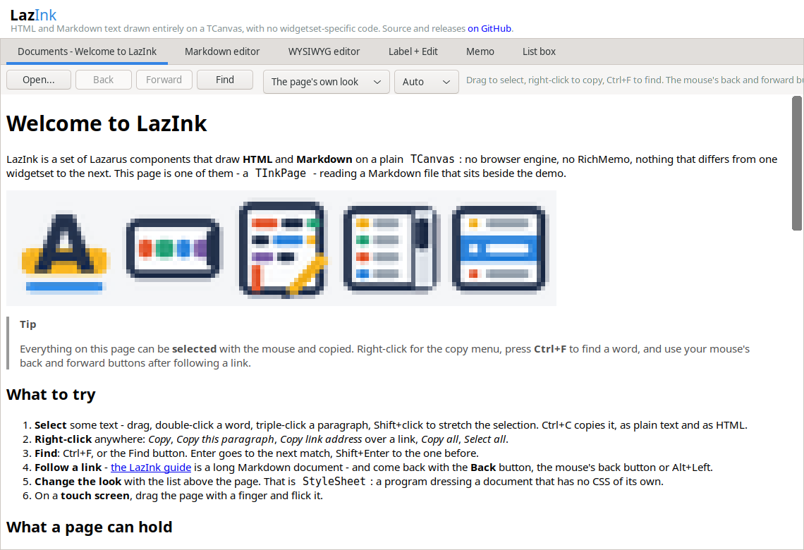
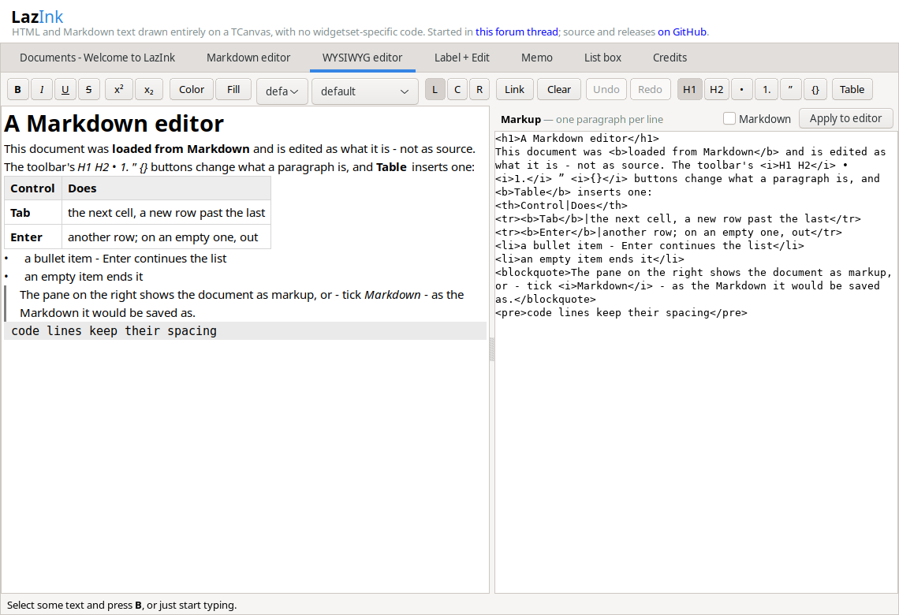
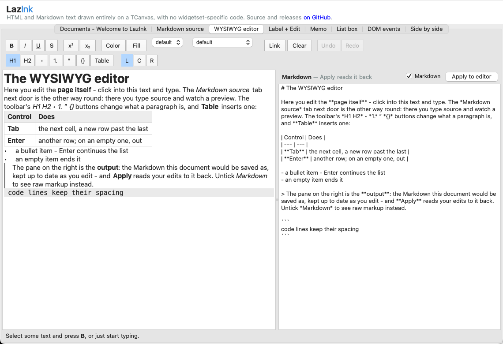

# LazInk

**Formatted text for Lazarus, drawn entirely on a `TCanvas`.** Labels,
memos, list boxes, a document viewer and a WYSIWYG Markdown editor that read
**HTML or Markdown** and look the same on every widgetset - no RichMemo, no
browser engine, no dependencies beyond the LCL, and **0BSD licensed**.



## Features

* **Document viewer.** `InkPage1.LoadFromFile('help/index.html')` renders a
  help site: headings, lists, tables, highlighted code, PNG, animated GIF
  and WebP (decoded in Pascal, nothing to install), links with Back and
  Forward, find in page, selection and copy, touch scrolling. Layout follows
  the page's CSS, with light and dark `prefers-color-scheme`.
* **Markdown.** Every display control accepts `TextFormat := itfMarkdown`;
  the page loads whole `.md` documents with GitHub's rules.
* **WYSIWYG Markdown editor.** `TInkRichEdit` edits headings, nested lists,
  quotes, tables and fenced code in rendered form, and reads and writes
  Markdown. No other Lazarus component does this.
* **Selection.** Drag, double-click a word, Shift+arrows, a right-click copy
  menu, Ctrl+C as text and HTML - in the page, the memo, the list box, and
  the label when enabled.
* **Chat logs.** `TInkMemo.AppendBlock` appends a message with lists, tables
  and highlighted code as one entry with its own background color;
  `ReplaceLast` updates the last entry while a reply streams in.
* **Checked against Chromium.** A test harness renders every construct next
  to Chromium; line heights match exactly. The comparison page is in the
  repository.

## Example

```pascal
uses InkLabel, InkMemo, InkPage, InkMarkdown;

InkLabel1.Caption := 'Status: <b><font color="#00AA00">connected</font></b>';

InkMemo1.TextFormat := itfMarkdown;
InkMemo1.Append('**12:04** build finished, `0 errors`');

InkPage1.StyleSheet.Text :=
  'body { background: #23262c; color: #b8bcc4 } h2 { color: #4ab3e8 }';
InkPage1.LoadMarkdown(ReleaseNotes);
```



## The controls

| Control | What it is |
|---|---|
| `TInkPage` | scrolling viewer for complete HTML/Markdown documents |
| `TInkMemo` | a list of formatted lines that grows, for a log or a chat |
| `TInkLabel` | a caption with inline markup |
| `TInkListBox` | formatted items with an in-place editor |
| `TInkRichEdit` | the WYSIWYG editor, Markdown in and out |
| `TInkEdit` | a one-line edit; an event sets each character's color |
| `TInkCodeMemo` | a plain multi-line editor that can grow with its text |

## Install

Open `lazink.lpk` with **Package → Open Package File**, then
**Compile → Use → Install**. The controls are on the **LazInk** palette
tab. The demo is `demo/lazinkdemo.lpi` - a tab for every control, built
in the form designer.

> **Status: 1.0.0.0.** Usable, and the API may still change. Developed
> with FPC 3.3.1 and Lazarus trunk on GTK3/Linux, and tested on macOS/Cocoa
> with the released Lazarus 4.8 and FPC 3.2.4. The other widgetsets have
> not been run yet; test reports are welcome.

## On a Mac

The package and the demo build and run on macOS Sequoia 15 with the Cocoa
widgetset - an Intel virtual machine, Lazarus 4.8 and FPC 3.2.4 - and the
whole test suite passes there: document tree, styles, layout, renderer and
interaction, Markdown, WebP. Apple Silicon has not been tried.



[Every tab of the demo on macOS](images/macos/README.md).

## Learn more

* **[The guide](docs/GUIDE.md)** - every control, feature and limit, in detail.
* **[Writing pages](docs/HTML_SUPPORT.md)** - every tag and CSS property it reads, with examples.

## License

[0BSD](LICENSE), the BSD Zero Clause License. The default stylesheet and the
character-name table come from the WHATWG HTML standard (CC BY 4.0), and the
WebP decoder's tables from RFC 6386 (BSD terms); both are credited in
[LICENSES/THIRD-PARTY.md](LICENSES/THIRD-PARTY.md). A program that uses
`TInkPage` should carry the RFC 6386 notice in its documentation.
